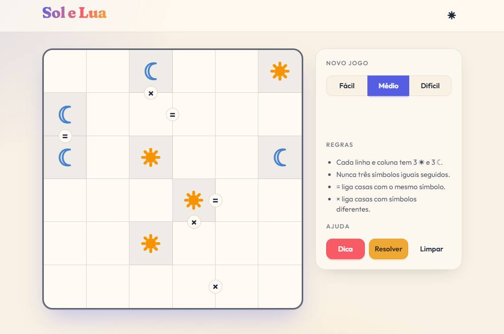

# Sol e Lua

Quebra-cabeça de lógica numa grade 6x6, feito para o trabalho final de Paradigmas de Programação. O Prolog gera e resolve os puzzles, o Elm desenha a interface, e o Python só faz a ponte entre os dois. Inspirado no Tango, do LinkedIn, que é uma variante do jogo Binário (Takuzu).



## Regras

- Cada linha e cada coluna tem 3 sóis e 3 luas.
- Nunca há três símbolos iguais seguidos.
- Casas ligadas por `=` têm o mesmo símbolo.
- Casas ligadas por `×` têm símbolos diferentes.

Clique numa casa para trocar entre vazia, sol e lua. As casas erradas ficam vermelhas.

## Requisitos

- [SWI-Prolog](https://www.swi-prolog.org/Download.html) 9.2 ou mais novo,
  com o `swipl` no PATH
- [uv](https://docs.astral.sh/uv/)
- [Node.js](https://nodejs.org) 20 ou mais novo

No Windows, se `swipl --version` não funcionar, rode este comando uma vez e
abra um terminal novo:

```powershell
[Environment]::SetEnvironmentVariable('Path', [Environment]::GetEnvironmentVariable('Path','User') + ';C:\Program Files\swipl\bin', 'User')
```

## Como rodar

Em dois terminais, a partir desta pasta:

```sh
# terminal 1: backend
cd backend
uv sync
uv run fastapi dev app/main.py

# terminal 2: frontend
cd frontend
npm install
npm run dev
```

Depois, abra http://localhost:5173.

Com `make` instalado, basta `make install` uma vez e depois `make dev`.

## Testes

```sh
swipl -g run_tests -t halt backend/prolog/test_solelua.pl
cd backend && uv run pytest
```
