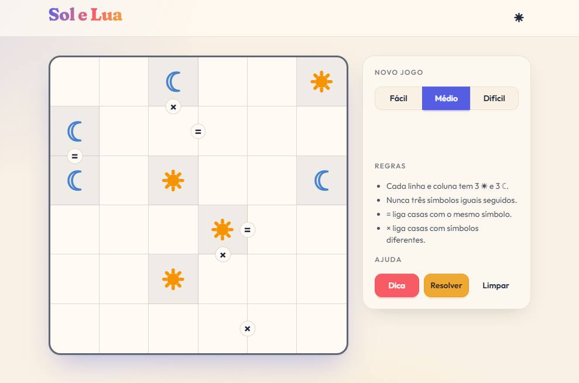

# Sol e Lua

## 1. Identificação

| Nome completo | Matrícula | Turma (14h/16h) | Usuário GitHub |
|---------------|-----------|-----------------|----------------|
| Kauan de Torres Eiras| 232014727  | 16h     | [@kauaneiras](https://github.com/kauaneiras) |

- **Nome do projeto:** Sol e Lua
- **Nome do grupo:** Equipe Kauan
- **Repositório:** [Sol-E-Lua](https://github.com/kauaneiras/Sol-E-Lua)
- **Commit ou tag entregue:** [`a1b2c3d` ou `v1.0`]
- **Ponto de partida:** Jogo Tango do Linkedin
- **Slides da apresentação oral:** não há

## 2. Resumo

Sol e Lua é um quebra-cabeça inspirado no [Tango](https://www.linkedin.com/games/tango/), do LinkedIn, também conhecido como Binário ou Takuzu.
Em uma grade 6x6, o jogador preenche cada casa com um sol ou uma lua, respeitando quatro regras:
1. 3 sóis e 3 luas por linha e coluna;
2. Não pode haver mais que dois sois ou luas seguidos;
3. Respeitar os sinais `=` e `×` entre casas vizinhas. 

O Prolog gera puzzles com solução única, resolve o tabuleiro e dá dicas; o Elm desenha a interface e marca na hora as casas que quebram alguma regra.



## 3. Como executar

**Requisitos**:

- SWI-Prolog 11.0.0 (o comando `swipl` precisa estar no PATH)
- Node.js 26.12.1, com npm 11.20.0
- uv 0.12.19 (instala o Python 3.14 sozinho)

**Instalação e execução:**

```sh
make install    # instalar dependências
make dev        # sobe backend (porta 8000) e frontend (porta 5173)
```

Sem `make`, em dois terminais:

```sh
# terminal 1
cd backend
uv sync
uv run fastapi dev app/main.py

# terminal 2
cd frontend
npm install
npm run dev
```

Depois, abrir http://localhost:5173.


## 4. Arquitetura

```
┌──────────────────────┐   HTTP/JSON   ┌───────────────────┐  janus  ┌──────────────────┐
│ Navegador            │ ────────────▶ │ FastAPI (Python)  │ ──────▶ │ SWI-Prolog       │
│ Elm + daisyUI (Vite) │ ◀──────────── │ backend/app/      │ ◀────── │ backend/prolog/  │
└──────────────────────┘               └───────────────────┘         └──────────────────┘
```

| Parte  | Responsabilidade | Arquivos principais |
|--------|------------------|---------------------|
| Prolog | Regras do jogo como restrições; resolver, contar soluções, gerar puzzles com solução única e dar dicas | `backend/prolog/solelua.pl` |
| Elm    | Estado do jogo, tela, cliques e checagem instantânea de conflitos | `frontend/src/SolLua.elm`, `frontend/src/Api.elm`, `frontend/src/Main.elm` |
| Python | Integração: recebe JSON, chama o Prolog pelo janus e devolve JSON | `backend/app/prolog.py`, `backend/app/main.py` |

## 5. Parte em Prolog

### 5.1 Predicados principais

| Predicado | Local | O que faz |
|-----------|-------|-----------|
| `sol_lua_constraints(?Rows, +Equal, +Opposite)` | `backend/prolog/solelua.pl:41` | Declara as quatro regras do jogo sobre a grade |
| `valid_line(?Line)` | `backend/prolog/solelua.pl:52` | Uma linha ou coluna tem 3 sóis, 3 luas e nenhuma trinca |
| `no_three_in_a_row(?Line)` | `backend/prolog/solelua.pl:59` | Para cada trio vizinho, a soma fica entre 4 e 5 |
| `solve(+Puzzle, +Equal, +Opposite, -Solution)` | `backend/prolog/solelua.pl:97` | Resolve o tabuleiro com `labeling([ff], ...)` |
| `count_solutions(+Puzzle, +Equal, +Opposite, +Limit, -Count)` | `backend/prolog/solelua.pl:107` | Conta soluções até um limite; com limite 2, diz se a solução é única |
| `generate(+Difficulty, -Puzzle, -Equal, -Opposite)` | `backend/prolog/solelua.pl:136` | Gera tabuleiro completo aleatório, sorteia sinais e apaga casas mantendo a solução única |
| `random_signs(+Full, +Count, -Equal, -Opposite)` | `backend/prolog/solelua.pl:165` | Sorteia pares de casas vizinhas e os separa em `=` e `×` com `partition/4` |
| `hint(+Board, +Equal, +Opposite, -Result)` | `backend/prolog/solelua.pl:224` | Devolve uma casa vazia com seu símbolo, ou `complete`, ou `unsolvable` |

### 5.2 Conceitos do paradigma lógico utilizados

- [x] Fatos e regras como base de conhecimento: os níveis de dificuldade são fatos `level/3` (`solelua.pl:131`); os pares de vizinhos são enumerados por regras `neighbour_pair/1` (`solelua.pl:173`).
- [x] Unificação de padrões: `equal_in/2` (`solelua.pl:183`) usa a MESMA variável `V` nas duas casas, e só tem sucesso se os valores unificam; `cell_var/2` (`solelua.pl:88`) casa o 0 com uma variável nova.
- [x] Recursão (inclusive sobre listas): `no_three_in_a_row/1` (`solelua.pl:59`), `random_labeling/1` (`solelua.pl:157`) e `dig_holes/6` (`solelua.pl:188`).
- [x] Backtracking e múltiplas soluções: `count_solutions/5` enumera soluções por backtracking; `random_labeling/1` usa `member/2` como ponto de escolha; `neighbour_pair/1` gera todos os pares por backtracking.
- [x] `findall/3`, `bagof/3`, `setof/3` ou similares: `findall/3` com `limit/2` em `count_solutions/5` (`solelua.pl:110`) e em `random_signs/4`.
- [x] Corte (`!`) ou negação (`\+`), e por que foram necessários: o corte em `solve/4` deixa só a primeira solução; em `cell_var/2` impede que o 0 também seja mantido como número no backtracking; em `no_three_in_a_row/1` separa o caso recursivo do caso base.
- [x] Programação por restrições (CLP(FD) ou outra): `ins`, `global_cardinality/2`, `#=`, `#\=`, `#>`, `#<` e `labeling/2` em `sol_lua_constraints/3` e `solve/4`.
- [x] Predicados de ordem superior (`maplist`, `include`, `partition`): `maplist/2,3` para aplicar as regras a linhas, colunas e sinais; `include/3` em `clue_count/2`; `partition/4` em `random_signs/4`.

### 5.3 Trecho em destaque

```prolog
sol_lua_constraints(Rows, Equal, Opposite) :-
    length(Rows, 6),
    maplist(same_length(Rows), Rows),
    append(Rows, Cells),
    Cells ins 1..2,
    maplist(valid_line, Rows),
    transpose(Rows, Columns),
    maplist(valid_line, Columns),
    maplist(same_symbol(Rows), Equal),
    maplist(different_symbol(Rows), Opposite).

valid_line(Line) :-
    global_cardinality(Line, [1-3, 2-3]),
    no_three_in_a_row(Line).

no_three_in_a_row([A, B, C | Rest]) :-
    !,
    A + B + C #> 3,
    A + B + C #< 6,
    no_three_in_a_row([B, C | Rest]).
no_three_in_a_row(_).
```

O trecho (`solelua.pl:41` a `solelua.pl:64`) define as regras que fazem de um tabuleiro válido. Nele, cada casa da grade 6x6 é declarada como uma variável com domínio 1..2, onde 1 representa sol e 2 representa lua. O predicado `global_cardinality/2` exige exatamente três ocorrências de cada símbolo por linha, e o uso de `transpose/2` reaproveita essa mesma verificação nas colunas. Para impedir trincas consecutivas, a soma de quaisquer três casas vizinhas deve ficar estritamente entre 3 e 6 (três sóis somam 3 (1+1+1) e três luas somam 6 (2+2+2)), transformando a regra numa desigualdade linear que o CLP(FD) funciona bem, enquanto os sinais do tabuleiro viram comparações diretas (#= e #\=) entre variáveis.
Quando `solve/4` executa `labeling/2`, o resolvedor escolhe valores e propaga essas restrições a cada passo: se uma linha já tem três sóis, as casas restantes dela passam a assumir automaticamente o valor de lua, sem que seja necessário escrever condicionais (if). Com essa modelagem declarativa, o mesmo bloco de código atende a três operações distintas: 1. resolver um jogo (`solve/4`), 2. contar quantas soluções existem (`count_solutions/5`) e gerar tabuleiros completos (`random_full_grid/1`, tarefas que exigiriam algoritmos de busca separados em linguagens procedurais.

## 6. Parte em Elm

### 6.1 Modelo e mensagens

```elm
type Symbol
    = Sun
    | Moon

type Cell
    = Given Symbol
    | Guess Symbol
    | Revealed Symbol
    | Empty

type SignKind
    = Equal
    | Opposite

type alias Sign =
    { from : Position, to : Position, kind : SignKind }

type alias Puzzle =
    { board : Board, signs : List Sign }

type alias Model =
    { puzzle : Puzzle
    , difficulty : Difficulty
    , darkTheme : Bool
    , loading : Bool
    , error : Maybe String
    , edits : Int
    , visibleConflicts : Set Position
    }

type Msg
    = NewGame Difficulty
    | GotPuzzle (Result String Puzzle)
    | CellClicked Position
    | ThemeToggled Bool
    | HintRequested
    | GotHint (Result String Api.Hint)
    | SolveRequested
    | GotSolution (Result String Board)
    | ResetRequested
    | ErrorDismissed
    | ConflictTimerEnded Int
```

Escolhas (tipos em `frontend/src/SolLua.elm:37` a `frontend/src/SolLua.elm:79`,
`Model` e `Msg` em `frontend/src/Main.elm:46` e `frontend/src/Main.elm:75`):

- `Symbol` é um tipo próprio, e não `Bool` ou `Int`: não existe "símbolo 7",
  e o código diz `Sun` em vez de `True`.
- `Cell` guarda a ORIGEM do símbolo junto com ele. Uma pista é `Given Sun`,
  e não um `Sun` com um `Bool` "é pista" ao lado. Assim não há como
  representar "casa vazia que é pista", e `setCell` recusa alterar uma pista
  só olhando o construtor.
- `SignKind` com dois construtores substitui strings como `"="` e `"x"`: o
  `case` em `signConflicts` (`SolLua.elm:282`) é exaustivo, e o compilador
  avisaria se surgisse um terceiro tipo de sinal.
- `Puzzle` junta tabuleiro e sinais porque os dois sempre andam juntos: é o
  que vai para o Prolog na dica e na solução.
- `Maybe String` para o erro: ou há uma mensagem, ou não há. As respostas
  HTTP chegam como `Result String a`, e cada `Msg` `Got...` trata `Ok` e
  `Err` em ramos separados do `update`.
- `visibleConflicts` fica separado dos conflitos reais para que o vermelho
  só apareça 1,5 s depois da última mudança. `edits` numera as mudanças, e a
  mensagem `ConflictTimerEnded` carrega o número da edição que a disparou:
  se o tabuleiro mudou de novo nesse meio tempo, o temporizador antigo é
  ignorado (`boardChanged`, `Main.elm:164`).

### 6.2 Conceitos do paradigma funcional utilizados

- [x] Arquitetura Elm (Model, update, view): `frontend/src/Main.elm`, com `update` em `Main.elm:89`.
- [x] Custom types e `case` exaustivo: `Symbol`, `Cell`, `SignKind` em `SolLua.elm`; `cycle` (`SolLua.elm:331`) trata cada combinação de origem e símbolo.
- [x] `Maybe` e `Result` no lugar de null e exceções: `symbolOf : Cell -> Maybe Symbol`; respostas HTTP como `Result String a` em `Api.elm`.
- [x] Funções de ordem superior e aplicação parcial: `updateBoard` (`Main.elm:189`) recebe uma função `Board -> Board`, e `SolLua.setCell position cell` é passada parcialmente aplicada.
- [x] Composição (`|>`, `>>`): `toLists` usa `symbolOf >> Maybe.map symbolToInt >> Maybe.withDefault 0`; `conflicts` e `threeInARow` encadeiam com `|>`.
- [x] Decoders e encoders JSON: `puzzleDecoder`, `signDecoder` e `symbolDecoder` em `Api.elm:133`, `Api.elm:143` e `Api.elm:165`; `encodePuzzle` monta o corpo das requisições.
- [x] Comandos e subscriptions (efeitos controlados): `Api.generate`, `Api.hint` e `Api.solve` devolvem `Cmd msg`; o atraso do vermelho também é um `Cmd`, feito com `Process.sleep` e `Task.perform` (`Main.elm:164`). O jogo não precisa de subscriptions.
- [x] Imutabilidade e atualização de records: `{ model | puzzle = ... }` e `{ puzzle | board = board }` em `Main.elm`; `setCell` devolve um tabuleiro novo.

### 6.3 Trecho em destaque

```elm
signDecoder : SignKind -> Decoder Sign
signDecoder kind =
    Decode.list Decode.int
        |> Decode.andThen
            (\coords ->
                case coords of
                    [ r1, c1, r2, c2 ] ->
                        Decode.succeed { from = ( r1, c1 ), to = ( r2, c2 ), kind = kind }

                    _ ->
                        Decode.fail "um sinal deve ter 4 números"
            )
```

Esse decoder (`Api.elm:143`) valida e converte o JSON enviado pela API nos tipos da aplicação. O backend representa cada sinal como uma lista de quatro inteiros; o decoder lê essa lista e, por meio de casamento de padrões (pattern matching), aceita entradas com exatamente quatro elementos. Caso o formato seja diferente, a decodificação falha e o erro é tratado via `Result` para ser exibido na tela, impedindo que dados inválidos entrem no `Model`.
A mesma função atende tanto ao sinal = quanto ao ×: o tipo (kind) é recebido como parâmetro, permitindo que puzzleDecoder reutilize signDecoder duas vezes, uma para cada lista. A partir dessa etapa, o restante da aplicação manipula apenas registros do tipo Sign, garantindo que a estrutura esteja sempre bem formada.

## 7. Integração

| Rota / chamada | Entrada | Saída | Predicado Prolog |
|----------------|---------|-------|------------------|
| `POST /api/generate` | `{"difficulty": "medium"}` | `{"board", "equal", "opposite"}` | `generate/4` |
| `POST /api/solve` | `{"board", "equal", "opposite"}` | `{"board"}`, ou 422 sem solução | `solve/4` |
| `POST /api/hint` | `{"board", "equal", "opposite"}` | `{"row", "col", "value"}`, ou 422 | `hint/4` |

Tabuleiro: 6 listas de 6 inteiros (0 = vazia, 1 = sol, 2 = lua). Sinal:
`[linha1, coluna1, linha2, coluna2]`. O Pydantic rejeita com 422 qualquer
tabuleiro fora desse formato antes de chamar o Prolog (`backend/app/main.py`).

## 8. Testes e validação

- **Prolog (plunit, 15 testes,** `backend/prolog/test_solelua.pl`**):**
  solução do puzzle de exemplo; a solução mantém as pistas; três sóis
  seguidos e quatro luas numa linha não têm solução; os sinais `=` e `×`
  são respeitados; sinais contraditórios no mesmo par não têm solução; o
  tabuleiro vazio tem várias soluções; o puzzle gerado tem solução única e
  os sinais batem com a solução; dificuldade inválida lança erro; a dica
  cai numa casa vazia e bate com a solução; dica num tabuleiro completo
  devolve `complete`, e num tabuleiro cheio e errado devolve `unsolvable`.
- **API (pytest, 7 testes,** `backend/tests/test_api.py`**):** rotas, formato
  do JSON e códigos de status, inclusive 422 para tabuleiro malformado, sem
  solução ou já completo.
- **Manual, no navegador:** gerar puzzles nos três níveis; trocar casas
  (vazia → sol → lua → vazia); pistas não mudam ao clicar; três luas
  seguidas e uma linha com 4 luas ficam marcadas em vermelho depois de
  1,5 s, e o vermelho some na hora quando o erro é desfeito; dica e
  "Resolver" preenchem as casas e mostram a mensagem de conclusão; com o
  backend desligado, aparece a mensagem de erro de conexão.
- **Casos de borda:** tabuleiro sem solução (mensagem de erro, sem travar);
  tabuleiro completo (botões de ajuda desativados); "Resolver" ignora os
  palpites errados do jogador e envia só as pistas.

## 9. Limitações e problemas conhecidos

- A dica revela uma casa vazia sorteada, sem explicar por que ela tem aquele símbolo. 
- A dificuldade é medida pela quantidade de pistas e de sinais, e não pelo raciocínio necessário. O gerador é guloso: se não consegue apagar mais casas sem perder a unicidade, para acima do alvo.
- O tabuleiro tem tamanho fixo 6x6 (no Prolog e no Elm).
- Não há testes automatizados no Elm (elm-test); a lógica de conflitos foi testada manualmente.
- Não há teclado: o jogo só funciona com cliques.
- O trabalho foi feito por uma só pessoa, abaixo do tamanho de grupo previsto (3 a 7).

## 10. Contribuição de cada integrante

| Integrante | Principais contribuições |
|------------|--------------------------|
| Kauan de Torres Eiras | Todo o projeto: regras, gerador e testes em Prolog; tipos, API e tela em Elm; integração e relatório |

## 11. Fontes, código de terceiros e uso de IA

**Código reaproveitado.** O projeto partiu do template do Sudoku da
disciplina (`fabiommendes/paradigmas-trabalho-final`). Foram mantidos a
integração Python (estrutura de `prolog.py` e `main.py`), o Makefile, a
configuração do Vite e o `style.css` (com a grade trocada para 6x6 e estilos
novos para os símbolos e sinais). `solelua.pl` segue a mesma organização do
`sudoku.pl`: `grid_vars/2`, `count_solutions`, `dig_holes`,
`random_labeling/1` e `hint` foram adaptados de lá. `SolLua.elm`, `Api.elm`
e `Main.elm` foram reescritos a partir de `Sudoku.elm`, `Api.elm` e
`Main.elm` do template.

**Referências.** As regras do jogo (Binário/Takuzu com sinais de igual e
diferente) são inspiradas no jogo Tango, do LinkedIn. Documentação do
SWI-Prolog (CLP(FD), janus e plunit), Elm Guide e material das aulas da
disciplina.

**Uso de ferramentas de IA.**

- **Faixa de uso no código:** auxiliar

| Ferramenta | Para que foi usada | Como o grupo verificou o resultado |
|------------|--------------------|------------------------------------|
| Claude Code, Github Copilot | Após pegar o template, escrevi comentários do que gostaria de fazer e o github copilot foi me ajudando dando dicas de como completar o código com a sintaxe certa. O Claude Code me ajudou a verificar se os critérios foram atendidos, planejar testes e ajustar textos nos arquivos markdown | Rodei os testes plunit e pytest, compilei com `elm make`, joguei no navegador e estudei cada arquivo ter certeza que entendi para explicá-lo |

## 12. Apresentação oral

- **Slides:** não há
- **Roteiro:**

| Parte | Duração | Quem apresenta |
|-------|:-------:|----------------|
| Contexto e regras do jogo | 2 min | Kauan de Torres Eiras |
| Demonstração | 5 min | Kauan de Torres Eiras |
| Código Prolog | 3 min | Kauan de Torres Eiras |
| Código Elm | 3 min | Kauan de Torres Eiras |
| Limitações e aprendizados | 2 min | Kauan de Torres Eiras |

## 13. Reflexão sobre os paradigmas

O Prolog me surpreendeu pela forma de resolver problemas. Em vez de programar o passo a passo da solução, como uma solução procedural, só precisa descrever as restrições do jogo e ele encontra a resposta sozinho. As quatro regras do Sol e Lua cabem em poucas linhas em sol_lua_constraints, e esse mesmo trecho resolve o tabuleiro, conta soluções e ainda gera puzzles novos com solução única, algo que em Python ou Javascript exigiria um algoritmo de busca inteiro. Já o Elm é interessante porque o compilador trabalha a favor de quem programa. Com tipos como Cell, que separa pista, palpite e casa revelada, certos erros simplesmente não conseguem acontecer, e se eu esquecer de tratar algum caso o código nem compila. No fim, cada linguagem ficou com o que faz de melhor, o Prolog buscando respostas a partir de regras e o Elm cuidando da tela e conferindo os erros do jogador na hora.